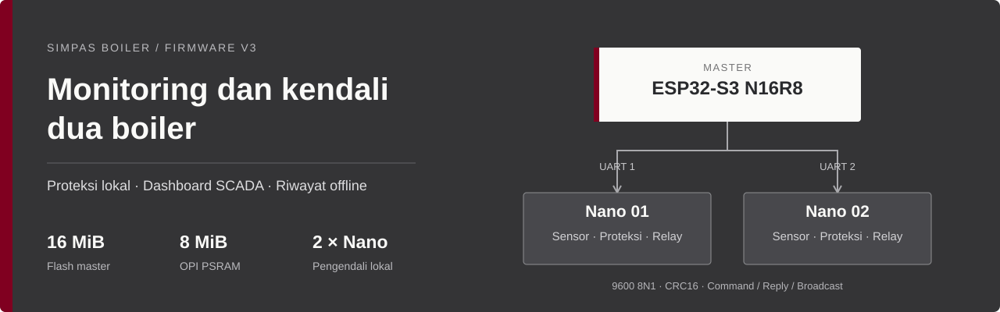
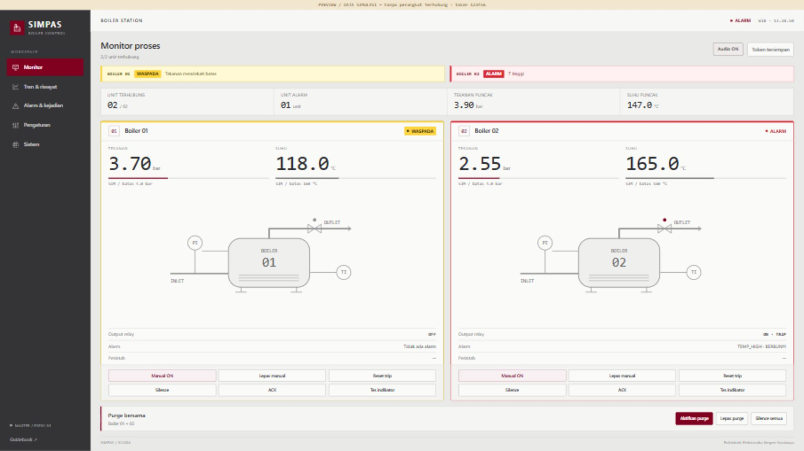
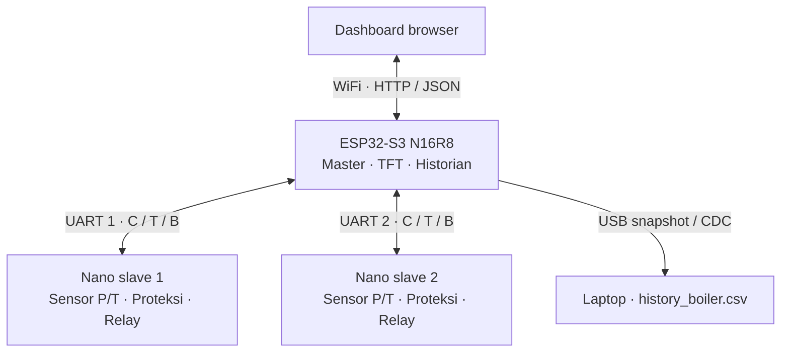

<!-- GUIDEBOOK_LINK: ganti #guidebook-proyek dengan URL yang akan diberikan pemilik proyek. -->
> 📖 **[Guidebook proyek](#guidebook-proyek)** — tautan guidebook baru akan ditambahkan di sini.

# SIMPAS BOILER

**Sistem Monitoring & Proteksi Automatis Solenoid Boiler**

Proyek Mikrokontroler Lanjut · Politeknik Elektronika Negeri Surabaya



[](https://github.com/riezky-gitH/SIMPAS-BOILER/actions/workflows/checks.yml)


[](LICENSE)

SIMPAS mengawasi tekanan dan suhu pada **dua boiler** melalui ESP32-S3 sebagai master dan dua Arduino Nano sebagai pengendali lokal. Masing-masing slave membaca sensor dan menjalankan proteksi; master menyediakan dashboard SCADA, TFT, pengiriman perintah, serta riwayat yang dapat diakses tanpa internet.

**[Panduan pengguna](Docs/PANDUAN_PENGGUNA_SINGKAT.md)** · **[Pinout](Docs/HARDWARE_PINOUT.md)** · **[Build & konfigurasi](Docs/GUIDEBOOK.md#3-dependensi-dan-build)** · **[Implementasi](Docs/IMPLEMENTATION_V3.md)**

## Guidebook proyek

Tautan guidebook baru menyusul dari pemilik proyek. Tempat tautannya sudah disiapkan di **bagian paling atas README**.

Sambil menunggu, gunakan [panduan pengguna singkat](Docs/PANDUAN_PENGGUNA_SINGKAT.md) untuk mengoperasikan board dan [dokumentasi teknis](Docs/GUIDEBOOK.md) untuk konfigurasi, protokol, build, dan troubleshooting.

## Dashboard



*Preview menggunakan data simulasi. Tampilan ini bukan bukti pengukuran atau koneksi perangkat fisik.*

- Dua kartu boiler dengan tekanan, suhu, sumber pembacaan, dan status keluaran.
- Notifikasi **ALARM merah** dan **WASPADA kuning**, tanpa pop-up untuk trip yang hanya tertahan.
- Alarm audio dua nada, grafik P/T, event, pengaturan ambang, dan ekspor CSV.
- Monitor desktop menyesuaikan viewport; Guidebook dan kontrol bawah tetap terlihat. Ponsel memakai layout yang dapat digulir.

Audio aktif setelah interaksi awal atau tombol **Audio AKTIFKAN**, mengikuti kebijakan browser. Silence, kondisi pulih, data terputus, atau Audio OFF menghentikan suara.

## Kemampuan sistem

| Bagian | Implementasi |
|---|---|
| **Proteksi lokal** | Evaluasi di Nano, histeresis, alarm per penyebab, silence/ACK, trip latch, dan reset setelah aman |
| **Kendali aktuator** | Purge lokal, remote, dan global; keluaran relay D9 aktif LOW, LED mengikuti keluaran |
| **Komunikasi** | Dua UART point to point, 9600 8N1, CRC16, sesi/sequence, retry, dan deduplikasi |
| **Broadcast demo** | Dummy P/T bertahap yang dikirim otomatis sekitar setiap 1 detik, tanpa menunggu polling |
| **Layar lokal** | TFT master lima halaman, border status, peak/insiden, informasi WiFi, dan QR repository |
| **Riwayat** | Ring PSRAM, journal LittleFS, logging 5 detik + kejadian threshold/alarm/relay |
| **Akses offline** | TFT, USB snapshot baca-saja, dan Serial `DUMP` |
| **Integrasi PC** | Proxy HTTP dan logger CSV/SQLite; MQTT bersifat opsional |

## Arsitektur



Frame **C** membawa command master, **T** membalas transaksi tertentu, dan **B** membawa telemetri otomatis dengan sequence 0. Frame B tidak dianggap sebagai konfirmasi command. Kontrol lokal slave tetap berjalan saat dashboard tidak tersedia.

## Mulai menggunakan

| Akses | Nilai |
|---|---|
| WiFi master | `SCADA_BOILER_PLTU` |
| Password WiFi | `00000000` |
| Dashboard board | **http://192.168.4.1** |
| Kode kontrol | **`123456`** — masukkan pada Akses operator |
| USB Serial master | `115200` baud, Newline |

1. Cocokkan wiring dan catu dengan [pinout](Docs/HARDWARE_PINOUT.md), lalu unggah firmware yang sesuai ke ketiga board.
2. Sambungkan HP/laptop ke WiFi master dan buka alamat dashboard di atas.
3. Simpan kode kontrol untuk mengirim perintah; pastikan jam HP/laptop benar agar waktu riwayat tersinkron.
4. Gunakan monitor untuk membaca data dan halaman pengaturan untuk mengubah ambang masing-masing boiler.

**Hanya mengubah dashboard?** Jalankan generator aset, build, lalu upload **master ESP32 saja** dan refresh browser. Perubahan kode slave memerlukan upload Nano yang terkait. Preview `127.0.0.1:8765` di laptop menggunakan data simulasi, bukan API board.

### Demo broadcast

Pilih **SIM pada kedua selector sensor**, nonaktifkan **LIVE**, lalu tahan **PB2 + PB3 slave bersamaan selama 2 detik**. LCD menampilkan `DEMO AUTO ON`; nilai bergerak bertahap dan dikirim otomatis. Ulangi kombinasi untuk berhenti.

Profil presentasi dipercepat agar alarm mudah didemokan. Pada uji native dari nol dengan ambang default, alarm pertama tercapai paling lambat 18 detik untuk 80 kombinasi node/seed. Itu hasil simulasi, bukan jaminan waktu fisik. Mematikan demo tidak menghapus trip atau purge. [Detail mode broadcast →](Docs/DEMO_BROADCAST.md)

### Riwayat lokal

Ring PSRAM menyimpan data live setiap 1 detik. Flash mencatat rutin setiap **5 detik**, ditambah catatan segera saat threshold dilintasi, penyebab alarm baru muncul, atau relay mulai aktif. Flush dilakukan sekitar **4 KiB / 60 detik**.

Ekspor `history_boiler.csv` berisi **waktu WIB, tekanan/suhu kedua slave, dan status masing-masing slave**. Gunakan dashboard, USB native, atau Serial `DUMP`. Setelah menyalin dari drive USB, lakukan **Eject**. [Panduan USB & history →](Docs/USB_HISTORY.md)

## Build dan pengujian

Master menggunakan **ESP32-S3 N16R8**, flash **16 MiB QIO**, PSRAM **8 MiB OPI**, CDC aktif, dan partisi LittleFS **10 MiB**. Kedua Nano memakai ATmega328P dengan profil old bootloader pada build yang diverifikasi. Versi core/library dan pengaturan lengkap ada di [panduan build](Docs/GUIDEBOOK.md#3-dependensi-dan-build).

Jalankan dari root repository:

```powershell
python Tools/sync_assets.py
python Tools/build_firmware.py --target all

node Tests/dashboard.test.cjs
python -m unittest discover -s Tests -p "test_*.py" -v
```

Build helper **tidak melakukan upload**. Header Arduino lokal dan HTML embedded dihasilkan dari sumber bersama agar sketch dapat dibuka langsung dalam Arduino IDE.

| Verifikasi lokal | Hasil |
|---|---|
| JavaScript dashboard | 31 kasus lulus |
| Python tools dan layanan lokal | 8 kasus lulus |
| C++ portable | 7 suite lulus |
| Kompilasi | Master dan kedua Nano berhasil |

[GitHub Actions](https://github.com/riezky-gitH/SIMPAS-BOILER/actions) menjalankan regresi portable. [Snapshot verifikasi build](Docs/verification/current-build.json) mencatat profil dan cakupan pemeriksaan lokal. Hasil software/build tidak menggantikan uji wiring, kalibrasi, power loss, atau aktuator fisik.

## Dokumentasi

| Kebutuhan | Baca |
|---|---|
| Mengoperasikan board | [Panduan pengguna singkat](Docs/PANDUAN_PENGGUNA_SINGKAT.md) |
| Build, konfigurasi, protokol | [Dokumentasi teknis](Docs/GUIDEBOOK.md) |
| Wiring | [Pinout hardware](Docs/HARDWARE_PINOUT.md) |
| Alarm web, audio, dan rasio layar | [Dashboard alarm & layout](Docs/DASHBOARD_ALARM_DAN_LAYOUT.md) |
| Dummy otomatis | [Demo broadcast](Docs/DEMO_BROADCAST.md) |
| Menyalin history | [USB history](Docs/USB_HISTORY.md) |
| Modul relay dua channel | [Pemeriksaan relay](Docs/RELAY_DUA_CHANNEL.md) |
| Penjelasan implementasi | [Implementasi dan verifikasi v3](Docs/IMPLEMENTATION_V3.md) |

## Struktur repository

```text
Firmware/
  Master_ESP32S3/    Master, TFT, historian, USB, dan dashboard embedded
  Slave1_Nano/      Sketch node 1 dengan header hasil generate
  Slave2_Nano/      Sketch node 2 dengan header hasil generate
  Shared/           Kontrol, protokol, UI, broadcast, dan utilitas bersama
  SlaveCommon/      Implementasi slave untuk kedua ID
  WebDashboard/     Sumber HTML dashboard
Docs/               Panduan, diagram, dan verifikasi
Hardware/           KiCad, PDF fabrikasi, dan preview 3D
Tools/              Generator, build, logger, dan validator
Tests/              Regresi portable dan fixture preview
```

Ubah logika bersama di `Firmware/Shared` atau `Firmware/SlaveCommon`, lalu jalankan `Tools/sync_assets.py`. Konfigurasi router/broker pribadi dapat memakai `Secrets.h` yang diabaikan Git; gunakan [template kosong](Firmware/Master_ESP32S3/Secrets.example.h) sebagai acuan.

## Catatan proyek

Ini prototipe pendidikan. Status relay menunjukkan **perintah keluaran**, belum feedback posisi katup. CAD awal tetap perlu dicocokkan dengan wiring firmware; [file hardware](Hardware) tidak otomatis membuktikan kesesuaian perakitan.

Data RAM yang belum di-flush dapat hilang saat daya terputus. Retensi flash bergantung ukuran baris dan jumlah event; budget 9 MiB dengan baris 100 byte pada interval 5 detik memberi estimasi sekitar 5,5 hari. Inisialisasi filesystem baru harus dilakukan secara eksplisit; jangan memformat arsip yang ingin dipertahankan.

Lisensi [MIT](LICENSE).
